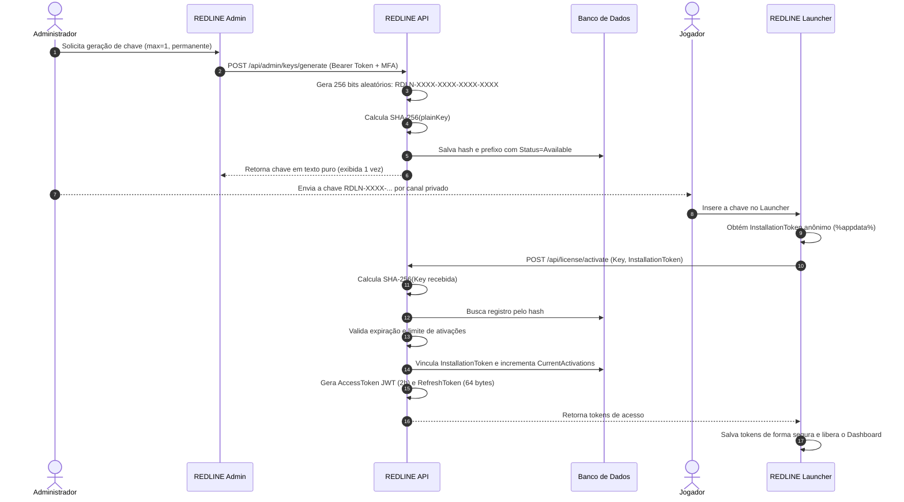

# 🏗️ REDLINE — Arquitetura de Software e Design do Sistema

Este documento descreve detalhadamente as decisões arquiteturais, padrões de projeto, fluxo de dados e segurança do ecossistema REDLINE.

---

## 1. Visão Geral da Arquitetura

O sistema é construído seguindo os princípios de **Clean Architecture** e **Separation of Concerns (SoC)**. Cada aplicação possui seu próprio domínio e responsabilidades delimitadas.

```
                    ┌───────────────────────────────────────────────┐
                    │               Redline.Core                    │
                    │  (Entidades, DTOs, Criptografia, A2S, Mods)   │
                    └───────┬───────────────┬───────────────┬───────┘
                            │               │               │
            ┌───────────────┘               │               └───────────────┐
            ▼                               ▼                               ▼
┌───────────────────────┐       ┌───────────────────────┐       ┌───────────────────────┐
│     Redline.Api       │       │    Redline.Launcher   │       │     Redline.Admin     │
│   (ASP.NET Core 8)    │       │     (WPF Desktop)     │       │     (WPF Desktop)     │
│  - Controladores REST │       │  - Views de Jogador   │       │  - Login com MFA      │
│  - Entity Framework   │       │  - Consulta A2S UDP   │       │  - Gerador de Chaves  │
│  - Rate Limiter       │       │  - Overlay DWM        │       │  - Revogação/Bloqueio │
│  - Auth JWT           │       │  - Sistema de Grupos  │       │  - Logs de Auditoria  │
└───────────────────────┘       └───────────────────────┘       └───────────────────────┘
```

---

## 2. Padrões de Projeto Adotados

1. **Repository & Service Pattern**: A API isola o acesso a dados (`AppDbContext`) através de serviços bem definidos (`KeyService`, `TokenService`, `AuditService`).
2. **DTO Pattern**: Nenhum modelo de banco de dados (`LicenseKey`, `Installation`) é exposto diretamente nas respostas públicas da API.
3. **Crypto Layer Centralizada**: Métodos de geração de chaves, hashing SHA-256 e PBKDF2 residem em `Redline.Core.Security.CryptoHelper`, permitindo testes unitários automatizados sem dependência externa.
4. **Transparent Win32 Layering**: A mira fixa é renderizada em uma janela independente com estilos de janela estendida do Windows (`WS_EX_TRANSPARENT | WS_EX_LAYERED | WS_EX_TOOLWINDOW | WS_EX_NOACTIVATE`), garantindo que não haja impacto no processador do jogo nem hooks de memória.

---

## 3. Modelo de Dados

### Tabela `LicenseKeys`
- `Id` (UUID, Primary Key)
- `KeyHash` (string, SHA-256 hex, Unique Index)
- `KeyPrefix` (string, e.g. "RDLN-XXXX")
- `Status` (enum: Available=0, Active=1, Expired=2, Revoked=3, Blocked=4)
- `CreatedAt` (DateTime UTC)
- `ExpiresAt` (DateTime UTC, opcional)
- `MaxActivations` (int, padrão 1)
- `CurrentActivations` (int, padrão 0)
- `Notes` (string, opcional)

### Tabela `Installations`
- `Id` (UUID, Primary Key)
- `LicenseKeyId` (UUID, Foreign Key para LicenseKeys)
- `InstallationToken` (string, UUID aleatório do cliente, Unique Index)
- `FriendlyName` (string, nome do computador)
- `ActivatedAt` (DateTime UTC)
- `LastSeenAt` (DateTime UTC)
- `IsBlocked` (bool)
- `BlockReason` (string, opcional)

### Tabela `AuditLogs`
- `Id` (UUID, Primary Key)
- `Action` (enum: KeyGenerated, KeyActivated, KeyRevoked, UnauthorizedAccess, etc.)
- `TargetId` (string, ID do recurso afetado)
- `PerformedBy` (string, usuário operador)
- `Details` (string, detalhes técnicos)
- `IpAddress` (string, endereço IP mascarado)
- `OccurredAt` (DateTime UTC, Index)

### Tabela `PartySessions`
- `PartyCode` (string, PK, e.g. "RL-7K9A")
- `HostInstallationToken` (string)
- `HostName` (string)
- `ServerIp` (string)
- `ServerPort` (int)
- `ServerName` (string)
- `ServerPassword` (string, opcional)
- `ModWorkshopIds` (lista serializada)
- `MemberNames` (lista serializada)
- `CreatedAt` (DateTime UTC)
- `ExpiresAt` (DateTime UTC)

---

## 4. Fluxo de Vida de uma Chave de Licença



---

## 5. Estratégia de Hospedagem a Custo Zero (R$ 0/mês)

| Provedor | Função | Nível Gratuito | Limites & Mitigações |
|---|---|---|---|
| **Render / Koyeb / Fly.io** | Hospedagem da REDLINE API | 750 horas/mês (container Linux) | Entra em suspensão após 15 min de inatividade. O Launcher exibe status "Conectando..." durante o cold start (~30s). |
| **Neon PostgreSQL / Supabase** | Banco de dados relacional em nuvem | 0.5 GB de armazenamento, pooling de conexões | Suficiente para milhares de chaves e logs de um grupo fechado de amigos. |
| **Cloudflare (Proxy / CDN)** | Proteção de IP de origem e SSL | Gratuito ilimitado | Oculta o IP real da infraestrutura e previne varreduras diretas. |
| **SQLite (Alternativa)** | Banco local embutido | Zero dependência | Utilizado por padrão no modo de desenvolvimento (`redline-dev.db`). |

